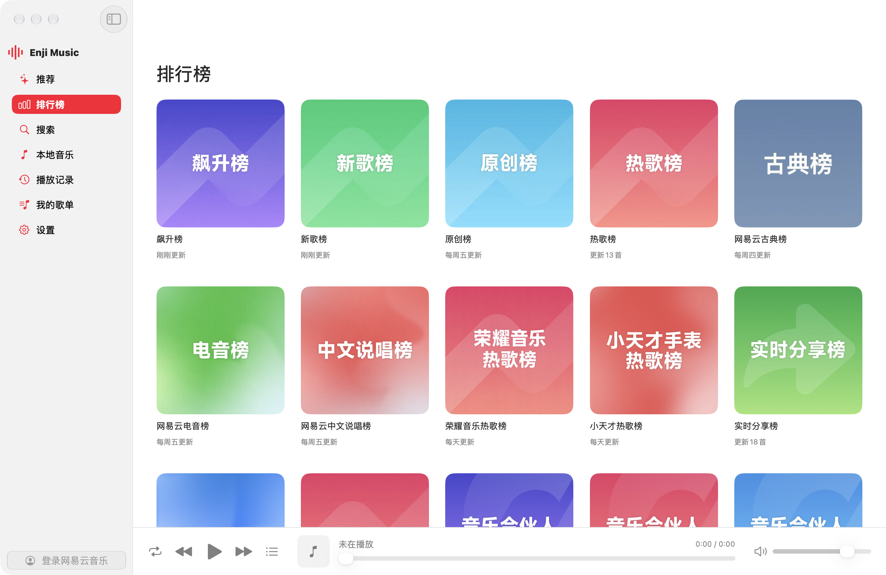
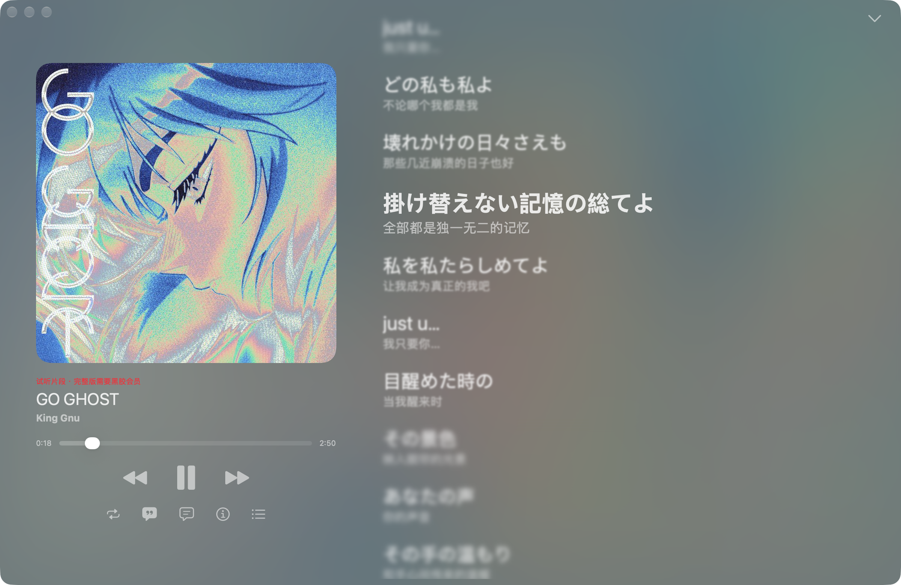
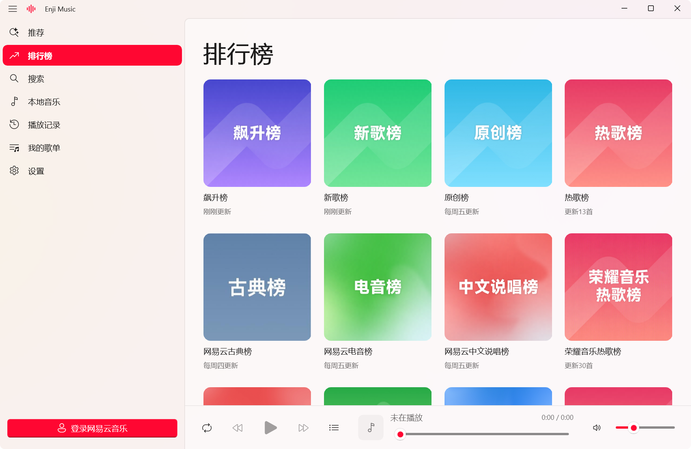
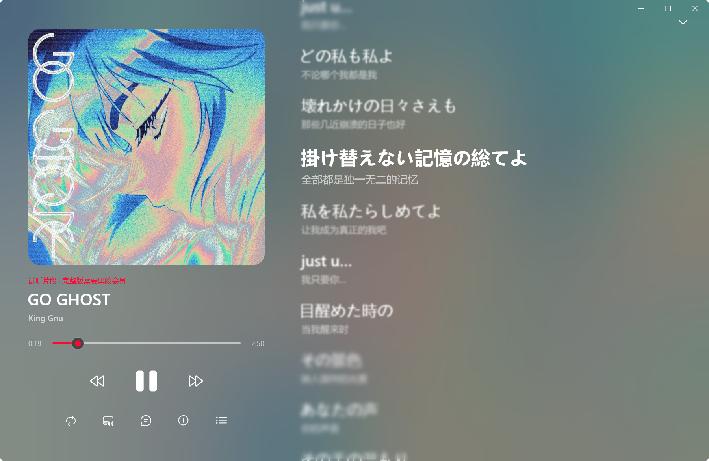
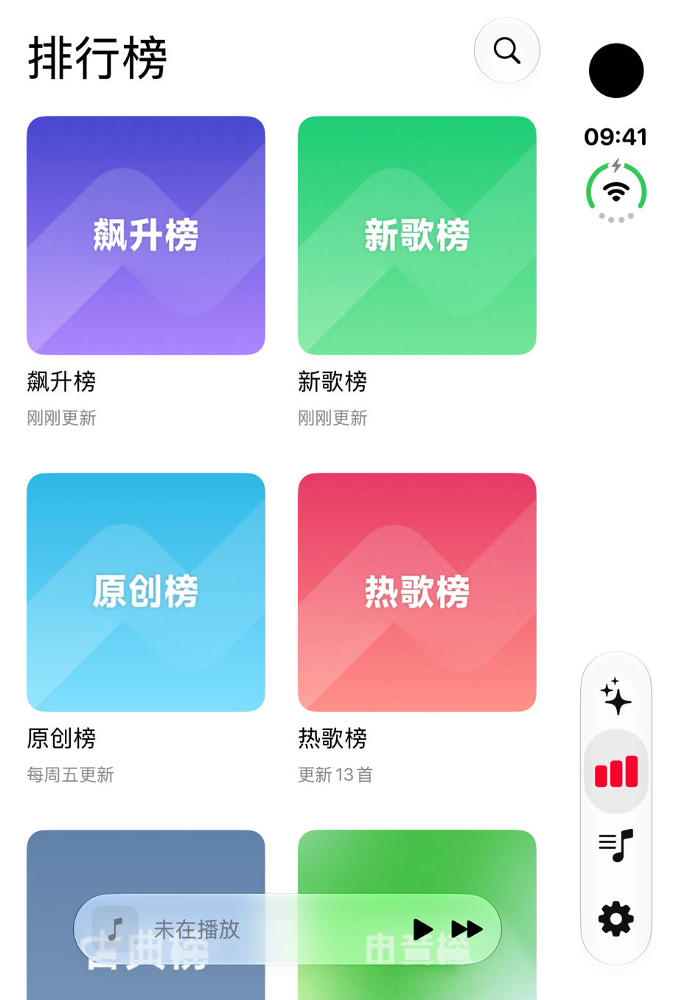
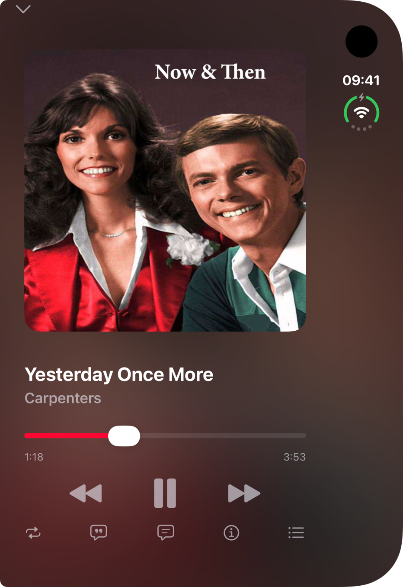
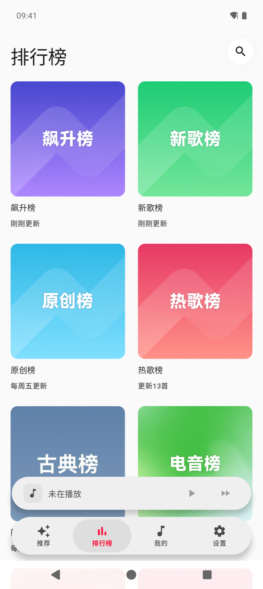
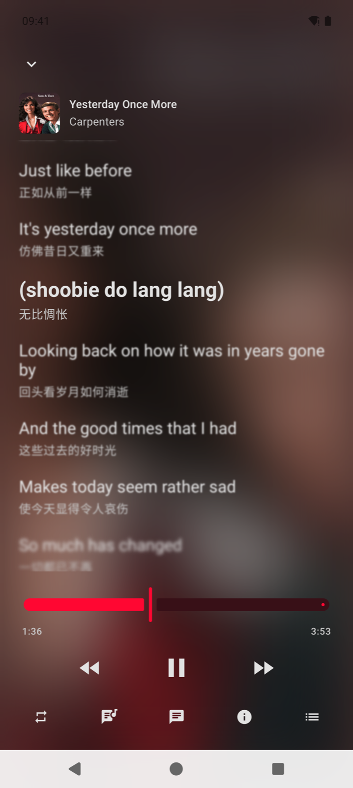
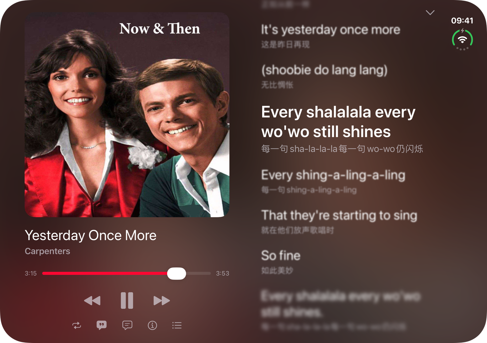

<div align="center">


<h1>Enji Music</h1>

<p><b>An unofficial, third-party NetEase Cloud Music client written in Rust, native on every platform.</b></p>

<p><sub>Not made by or affiliated with NetEase.</sub></p>

<p>

<a href="https://github.com/AimesSoft/Bern"></a>

</p>

<p>


<a href="LICENSE"></a>
</p>

<p><a href="README.md">简体中文</a> · <b>English</b></p>

</div>

<table>
<tr>
<td width="50%" align="center"><a href="docs/screenshots/macos-charts.png"></a><br><sub>macOS · Charts</sub></td>
<td width="50%" align="center"><a href="docs/screenshots/macos-now-playing.png"></a><br><sub>macOS · Now playing</sub></td>
</tr>
<tr>
<td width="50%" align="center"><a href="docs/screenshots/windows-charts.png"></a><br><sub>Windows · Charts</sub></td>
<td width="50%" align="center"><a href="docs/screenshots/windows-now-playing.png"></a><br><sub>Windows · Now playing</sub></td>
</tr>
</table>

<table>
<tr>
<td align="center"><a href="docs/screenshots/iphone-duo-outer-charts.png"></a></td>
<td align="center"><a href="docs/screenshots/iphone-duo-outer-now-playing.png"></a></td>
<td align="center"><a href="docs/screenshots/android-charts.png"></a></td>
<td align="center"><a href="docs/screenshots/android-lyrics.png"></a></td>
</tr>
<tr>
<td colspan="2" align="center"><sub>iPhone Duo outer screen</sub></td>
<td colspan="2" align="center"><sub>Android</sub></td>
</tr>
</table>

<p align="center"><a href="docs/screenshots/iphone-duo-inner-now-playing.png"></a><br><sub>iPhone Duo unfolded: the cover and the lyrics on either side of the hinge</sub></p>

## Highlights

- **Light.** The macOS `.app` is 13.9 MiB, 7 MiB zipped, and uses 61 MiB of memory sitting on the Charts page.
- **Lyrics with depth.** The line being sung is the sharpest; the lines around it blur away over the blurred cover.
- **Lyrics and covers for your own files.** Local FLAC and MP3 files pick up the lyrics and cover of the same song on NetEase, and you search them together with your online playlists. Turn NetEase off and Enji is a plain local player.
- **Usable by AI.** An MCP server and a command line come built in. An AI such as Claude can search, play and switch pages, reading the controls on screen rather than screenshots.

## Features

- **NetEase Cloud Music**: daily picks, recommended playlists and 60+ charts, with pages for every playlist, album and artist. Without signing in you can still browse charts, search and play free songs.
- **Sign in** with a QR code, an SMS code or a password. Your sign-in stays on your own device.
- **Your playlists**: liked songs, playlists you made or saved; create playlists, add songs to them, like a song.
- **Search** NetEase and your own music at once, with trending searches and your search history.
- **Lyrics** scroll with the song, with Chinese translations; tap a line to jump there. Song comments too.
- **Quality**: standard, higher, extreme, lossless or Hi-Res (above 320k needs NetEase VIP).
- **Your own music**: MP3, FLAC, M4A, WAV and other common formats. On a computer, add a folder; on iPhone, put songs in Enji's folder in the Files app; on Android, pick a folder.
- **History**: what you played recently, and how many times you played each song.
- **Looks**: light, dark or follow the system; Chinese or English.

## Download

Get it from [Releases](https://github.com/MCDFsteve/Enji/releases/latest): `.dmg` for macOS, `.ipa` for iPhone and iPad, `-setup.exe` for Windows, `.apk` for Android, `.deb` for Linux. The macOS, iOS and Windows builds aren't signed by a developer: install the `.ipa` with AltStore, Sideloadly or a similar tool, which signs it with your Apple ID; the release notes say how to open the others the first time.

## For AI

Every build puts an `enji` command line and `enji-mcp` in `target/bern/<platform>/bin/`, with every command described in `skills/enji/SKILL.md`.

```sh
enji search search --text "GO GHOST"
enji enji play --source Search --index 0
enji state
```

## How Enji does it

Enji is built with [Bern](https://github.com/AimesSoft/Bern), and most of the highlights above come straight from it.

**The interface is written once and compiled into each platform's own code.** Enji's screens are declared in Rust with Bern's `ui!`. At build time Bern turns them into SwiftUI, WinUI 3 (C++), Jetpack Compose (Kotlin) and GTK 4 (Rust) source, which Xcode, MSVC, Gradle and Cargo then compile. There is no custom renderer and no embedded web page at run time, which is why the macOS app is 14 MB.

**Layout is declared by screen width.** A phone layout on narrow screens and a sidebar on wide ones is this, in full:

```rust
// shell/ui/src/lib.rs
Adaptive(id: shell) {
    Layout(size: compact) { phone_shell(app: app) }
    Layout(size: expanded) { desktop_shell(app: app) }
}
```

The iPhone Duo switches to the wide layout the moment it unfolds, with not one line written for foldables.

**A protocol sits between the interface and the logic.** Each module's `protocol` declares, with `#[bern::protocol]`, the state the interface reads and the commands it calls; `core` is the Rust engine that carries them out, the same code on all five platforms. A button's `=> app.toggle()` calls the protocol's `fn toggle`:

```rust
// modules/enji/protocol/src/lib.rs
#[commands]
pub trait Commands {
    // …
    /// Play the song at `index` of a list, then the rest of the list.
    fn play(&mut self, source: Source, index: i64) -> Result<(), CommandError>;
    /// Pause, or play on.
    fn toggle(&mut self) -> Result<(), CommandError>;
    // …
}
```

If the interface names a command that doesn't exist, or a label is missing its English translation, `bern check` stops the build.

**The AI interface comes from the same protocol.** Every command and every control has a name, so Bern generates the `enji` command line, the `enji-mcp` server and `SKILL.md` from them. An AI running `enji enji play` goes through the same command as your tap on Play.

To build your own app the same way, have a look at [Bern](https://github.com/AimesSoft/Bern).

## Build from source

```sh
git clone https://github.com/MCDFsteve/Enji.git
cd Enji
cargo build --manifest-path vendor/bern/Cargo.toml -p bern-cli --release
vendor/bern/target/release/bern build --target macos --release
open target/bern/macos/Enji.app
```

`--target` also takes `windows`, `linux`, `android` or `ios`; build on a host for that platform.

| Target | Needs |
| --- | --- |
| macOS / iOS | Xcode 26 or later; for iOS also `rustup target add aarch64-apple-ios aarch64-apple-ios-sim` |
| Windows | Visual Studio C++ build tools and the Windows SDK |
| Android | JDK 21, the Android SDK and NDK, `rustup target add aarch64-linux-android` |
| Linux | GTK 4 and libadwaita development packages |

`vendor/bern/` is a Bern snapshot with the cover glow and blurred backdrop Enji uses, which upstream doesn't have yet; see [UPSTREAM.md](vendor/bern/UPSTREAM.md).

## Status

Browsing, search, playback and lyrics have been used on a real Mac and a real Windows PC, the iPhone Duo simulator and the Android emulator. Linux has only passed `bern check`.

## Disclaimer

- Enji is a third-party client, not an official NetEase Cloud Music app, and has no affiliation with NetEase.
- This project is for learning and technical exchange only.
- Enji only plays, through NetEase Cloud Music's own interfaces, what you could already listen to. It provides no music and does not get around VIP or copyright restrictions.
- Songs, lyrics and covers belong to NetEase Cloud Music and their respective rights holders.
- Follow NetEase Cloud Music's terms of service and the laws where you live; you are responsible for how you use this project.
- If you hold rights and believe this project infringes them, open an issue and it will be handled promptly.

## License and thanks

[MIT](LICENSE).

- [Bern](https://github.com/AimesSoft/Bern): the UI framework
- [ncm-api-rs](https://github.com/SPlayer-Dev/ncm-api-rs): the NetEase Cloud Music API
- [Misuzu Music](https://github.com/AimesSoft/MisuzuMusic): how shuffle, local song matching and the cover glow work
- [symphonia](https://github.com/pdeljanov/Symphonia), [rodio](https://github.com/RustAudio/rodio), [lofty](https://github.com/Serial-ATA/lofty-rs): decoding, playback and tags
- [Fluent UI System Icons](https://github.com/microsoft/fluentui-system-icons): the equalizer in the icon
