<div align="center">


<h1>Enji Music</h1>

<p><b>网易云音乐第三方客户端，电脑和手机都能用，小巧顺手。</b></p>

<p><sub>非网易云音乐官方出品，与网易公司无关。</sub></p>

<p>

<a href="https://github.com/AimesSoft/Bern"></a>

</p>

<p>


<a href="LICENSE"></a>
</p>

<p><b>简体中文</b> · <a href="README.en.md">English</a></p>

</div>

<table>
<tr>
<td width="50%" align="center"><a href="docs/screenshots/macos-charts.png">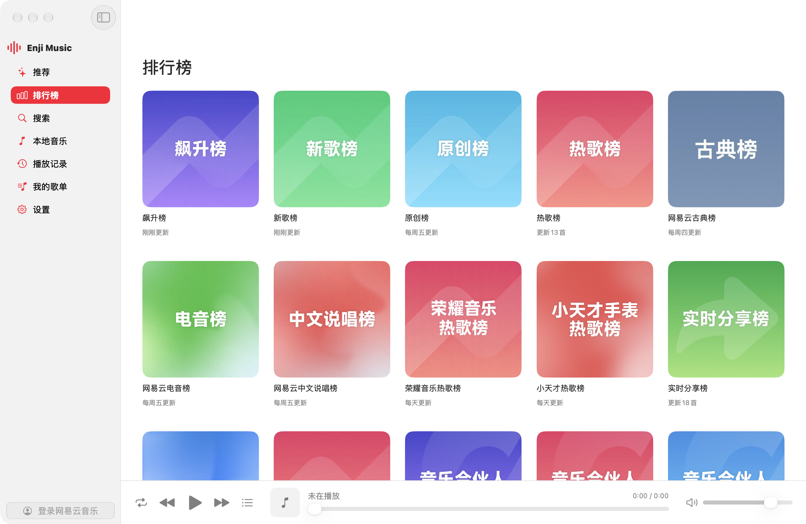</a><br><sub>macOS · 排行榜</sub></td>
<td width="50%" align="center"><a href="docs/screenshots/macos-now-playing.png">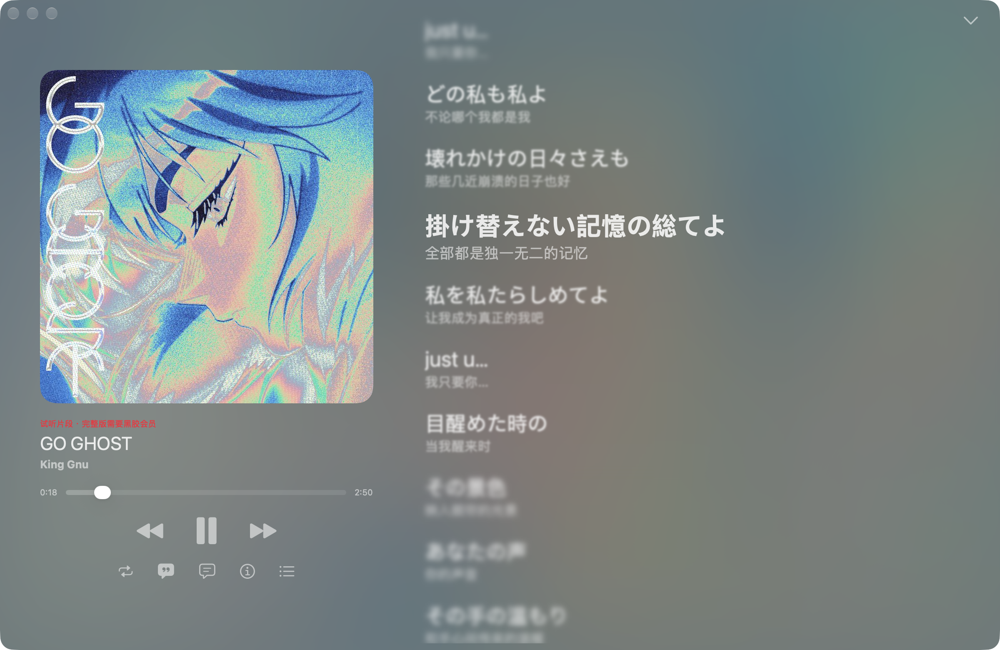</a><br><sub>macOS · 播放页</sub></td>
</tr>
<tr>
<td width="50%" align="center"><a href="docs/screenshots/windows-charts.png">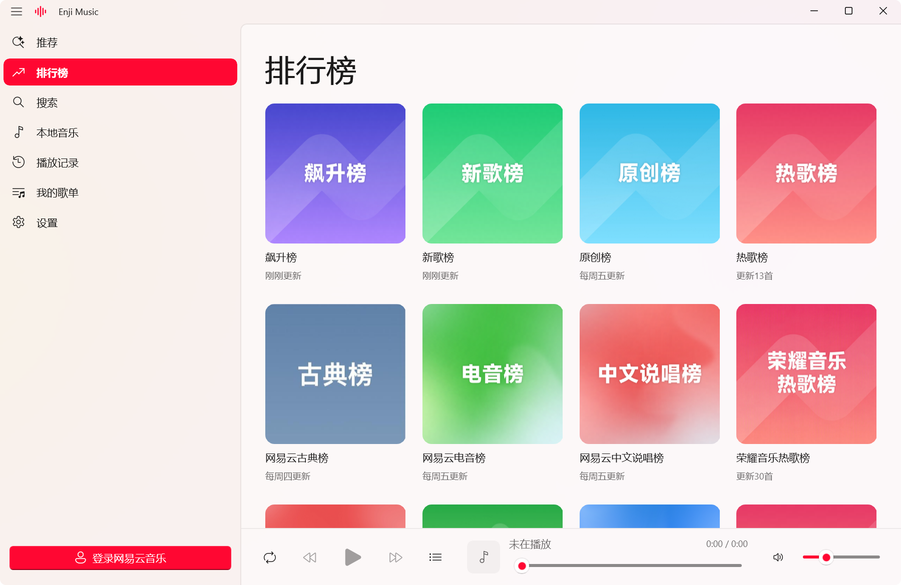</a><br><sub>Windows · 排行榜</sub></td>
<td width="50%" align="center"><a href="docs/screenshots/windows-now-playing.png">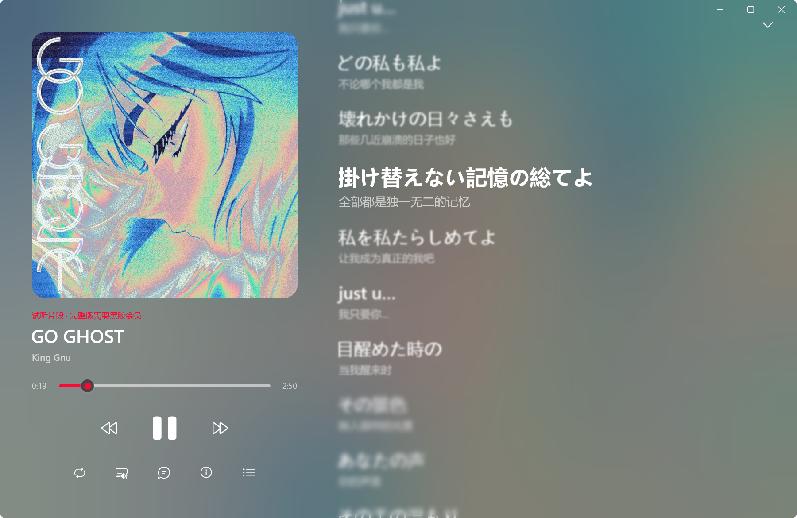</a><br><sub>Windows · 播放页</sub></td>
</tr>
<tr>
<td width="50%" align="center"><a href="docs/screenshots/linux-charts.png">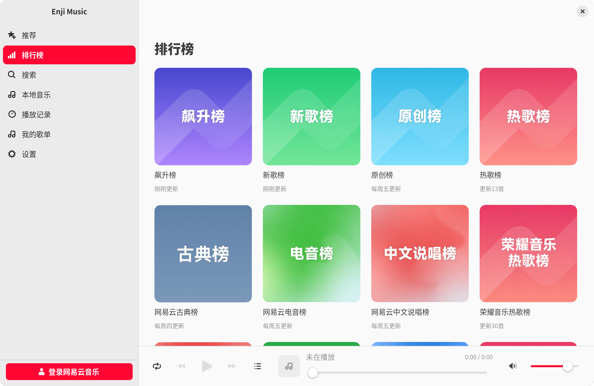</a><br><sub>Linux · 排行榜</sub></td>
<td width="50%" align="center"><a href="docs/screenshots/linux-now-playing.png">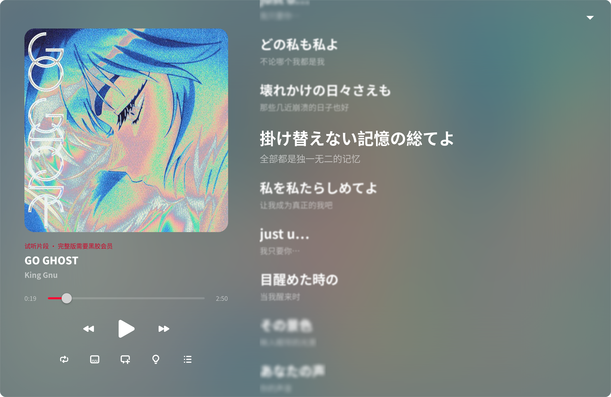</a><br><sub>Linux · 播放页</sub></td>
</tr>
</table>

<table>
<tr>
<td align="center"><a href="docs/screenshots/iphone-duo-outer-charts.png">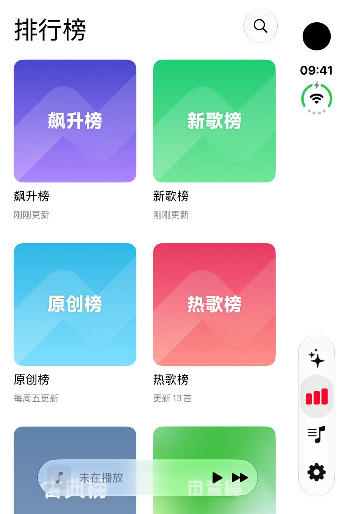</a></td>
<td align="center"><a href="docs/screenshots/iphone-duo-outer-now-playing.png">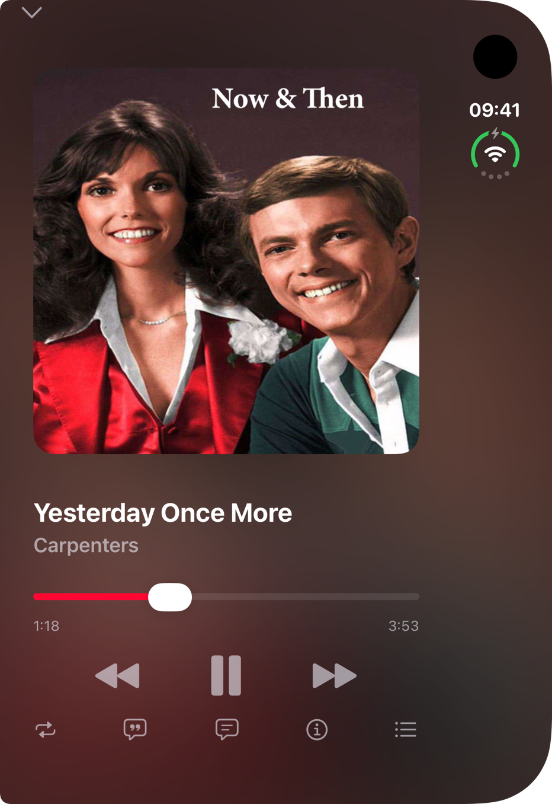</a></td>
<td align="center"><a href="docs/screenshots/android-charts.png">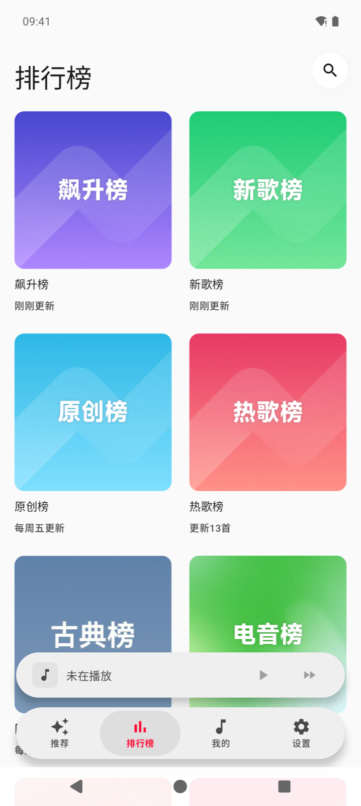</a></td>
<td align="center"><a href="docs/screenshots/android-lyrics.png">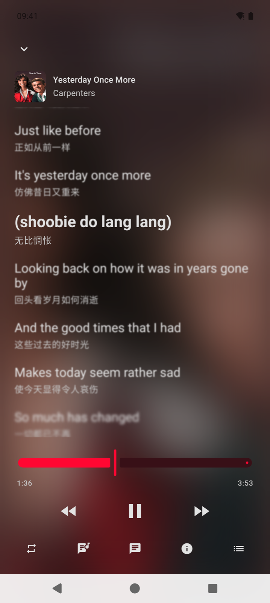</a></td>
</tr>
<tr>
<td colspan="2" align="center"><sub>iPhone Duo 外屏</sub></td>
<td colspan="2" align="center"><sub>Android</sub></td>
</tr>
</table>

<p align="center"><a href="docs/screenshots/iphone-duo-inner-now-playing.png">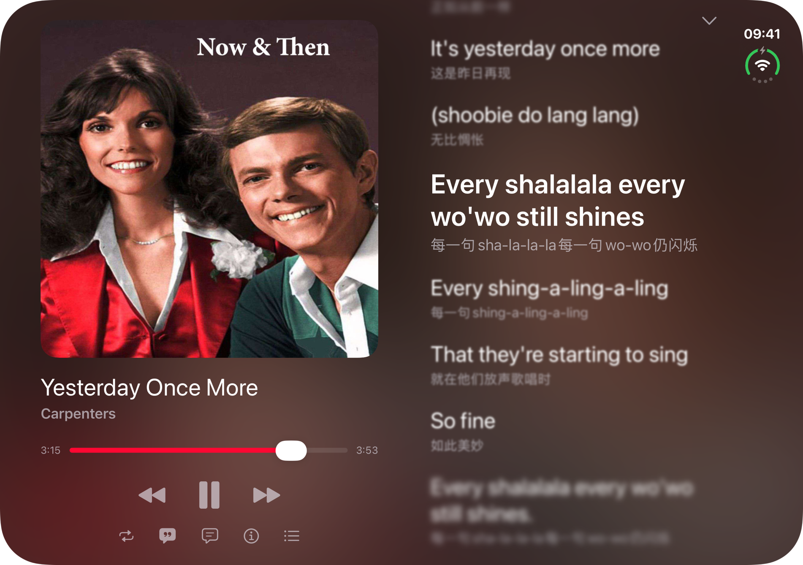</a><br><sub>iPhone Duo 展开：封面和歌词分在铰链两侧</sub></p>

## 特色

- **轻。** macOS 版 `.app` 13.9 MiB，压缩后 7 MiB；停在排行榜页时占用 61 MiB 内存。
- **有景深的歌词。** 正在唱的一行最清楚，上下几行逐渐虚化，背后铺着模糊的封面。
- **本地音乐也有歌词和封面。** 本机的 FLAC、MP3 会自动配上网易云里同一首歌的歌词和封面，和在线歌单在一个曲库里搜索。关掉网易云，Enji 就是一个纯本地播放器。
- **AI 能直接用。** 自带 MCP 服务器和命令行。Claude 这样的 AI 可以搜歌、放歌、切换页面，看的是界面上的控件，而不是截图。

## 功能

- **听网易云**：每日推荐、推荐歌单和 60 多个排行榜，歌单、专辑、歌手都能点进去看。不登录也能看排行榜、搜歌、听免费歌曲。
- **登录**：扫码、手机验证码或密码登录，登录信息只保存在你自己的设备上。
- **我的歌单**：我喜欢的音乐、自建和收藏的歌单；可以新建歌单、把歌加进去、给歌点红心。
- **搜索**：网易云和本机的歌一起搜，有热搜榜和搜索记录。
- **歌词**：跟着歌逐行滚动，带中文翻译，点一行就跳到那里；也能看歌曲评论。手机竖着拿时，封面下方也显示正在唱的那一行。
- **音质**：标准、较高、极高、无损、Hi-Res 可选（320k 以上需要网易云会员）。
- **本地音乐**：MP3、FLAC、M4A、WAV 等常见格式都能放，播放时写出格式和码率，例如“FLAC · 921 kbps · 44.1 kHz · 16 bit”。电脑上添加文件夹；iPhone 上把歌放进“文件”App 的 Enji 文件夹；Android 上选一个文件夹。
- **下载**：把歌连同歌词和封面存到本机，电脑上在“音乐”文件夹的 Enji 里。下载过的歌和本机的歌在列表里都有标记。
- **系统的播放控件**：键盘上的媒体键、macOS 菜单栏、iPhone 的锁屏和控制中心、Windows 的媒体浮窗、Linux 桌面的媒体控件、Android 的通知栏，都能看到正在放的歌并控制播放。切到别的 App 或锁屏后音乐不停。
- **桌面歌词**：电脑和 Android 上，歌词可以浮在所有窗口上面，拖到哪里就停在哪里。鼠标移上去（Android 上点一下）就能切歌、暂停和锁定；锁定后鼠标点击会穿过它。
- **插件**：在设置里的插件商店安装插件，比如 Windows 任务栏歌词、跟着鼓点跳动的封面。插件用 JavaScript 编写，见 [enji-plugins](https://github.com/MCDFsteve/enji-plugins)。
- **播放记录**：最近听过什么，每首歌听了几次。
- **外观**：浅色、深色或跟随系统，中文和英文界面；格式、封面下的歌词和桌面歌词都能在设置里关掉。

## 下载

到 [Releases](https://github.com/MCDFsteve/Enji/releases/latest) 下载：macOS 用 `.dmg`，iPhone / iPad 用 `.ipa`，Windows 用 `-setup.exe`，Android 用 `.apk`，Linux 用 `.deb`。macOS、iOS 和 Windows 版没有开发者签名：`.ipa` 需要用 AltStore、Sideloadly 等工具以自己的 Apple ID 签名安装，其余的第一次打开时怎么放行写在发布说明里。

## 交给 AI

每次构建都会在 `target/bern/<平台>/bin/` 生成 `enji` 命令行和 `enji-mcp`，`skills/enji/SKILL.md` 里是全部命令的说明。

```sh
enji search search --text "GO GHOST"
enji enji play --source Search --index 0
enji state
```

## Enji 是怎么做到的

Enji 用 [Bern](https://github.com/AimesSoft/Bern) 写成。上面的特色，大多是 Bern 直接带来的。

**界面写一次，编译成各平台自己的代码。** Enji 的界面用 Bern 的 `ui!` 声明写在 Rust 里。构建时，Bern 把它生成 SwiftUI、WinUI 3（C++）、Jetpack Compose（Kotlin）和 GTK 4（Rust）的源码，再交给 Xcode、MSVC、Gradle、Cargo 各自编译。运行时没有自绘引擎，也没有内嵌网页，所以 macOS 版只有 14 MB。

**布局按屏幕宽度声明。** 窄屏用手机布局，宽屏用侧边栏，整个切换就是这三行：

```rust
// shell/ui/src/lib.rs
Adaptive(id: shell) {
    Layout(size: compact) { phone_shell(app: app) }
    Layout(size: expanded) { desktop_shell(app: app) }
}
```

iPhone Duo 一展开就换成宽屏布局，没有一行专门给折叠屏的代码。

**界面和逻辑之间隔着一份协议。** 每个模块的 `protocol` 用 `#[bern::protocol]` 声明界面能读的状态和能调用的命令，`core` 是实现这些命令的 Rust 引擎，五个平台跑的是同一份。界面里按钮写 `=> app.toggle()`，调用的就是协议里的 `fn toggle`：

```rust
// modules/enji/protocol/src/lib.rs
#[commands]
pub trait Commands {
    // …
    /// Play the song at `index` of a list, then the rest of the list.
    fn play(&mut self, source: Source, index: i64) -> Result<(), CommandError>;
    /// Pause, or play on.
    fn toggle(&mut self) -> Result<(), CommandError>;
    // …
}
```

界面引用了不存在的命令，或者某句文案缺了英文翻译，`bern check` 在构建前就会报错。

**AI 接口来自同一份协议。** 协议里的每条命令、界面上的每个控件都有名字，Bern 据此生成 `enji` 命令行、`enji-mcp` 服务器和 `SKILL.md`。AI 执行 `enji enji play` 和你点播放按钮走的是同一条命令。

想用同样的方式写自己的应用，可以看看 [Bern](https://github.com/AimesSoft/Bern)。

## 从源码构建

Enji 用 [Bern](https://github.com/AimesSoft/Bern) 构建。先装上 Bern 的构建工具 `bern`，用 Enji 依赖的那一版：

```sh
cargo install --locked --git https://github.com/AimesSoft/Bern --rev 1e2a01f04b669375b8a790da5abb1ab218e86061 bern-cli
```

然后取得 Enji 并运行：

```sh
git clone https://github.com/MCDFsteve/Enji.git
cd Enji
bern run
```

`bern run` 构建并打开这台电脑上的版本；`bern build --target <平台> --release` 构建某个平台（`macos`、`ios`、`windows`、`linux`、`android`），`bern package` 生成安装包。`bern doctor` 会列出这台电脑构建各平台还缺什么，各平台需要的工具见 [Bern 的说明](https://github.com/AimesSoft/Bern#quick-start)。

## 现状

macOS 和 Windows 实机、Ubuntu 24.04 虚拟机（GNOME）、iPhone Duo 模拟器、Android 模拟器上实际用过浏览、搜索、播放和歌词。

系统的播放控件在 macOS、iPhone 模拟器、Android 模拟器和 Ubuntu 上试过，桌面歌词在 macOS 和 Android 上试过；Windows 上的这两样，以及 Linux 的桌面歌词，还没有实际试过。

## 免责声明

- Enji 是第三方客户端，不是网易云音乐官方出品，与网易公司无关。
- 本项目仅供学习和技术交流。
- Enji 只通过网易云音乐的接口播放你本来就能听的内容，不提供任何音乐资源，也不绕过会员和版权限制。试听片段不能下载；下载的歌请只用于个人收听，不要传播。
- 歌曲、歌词、封面等内容的版权归网易云音乐及各自的权利人所有。
- 使用时请遵守网易云音乐的用户协议和当地法律法规，因使用本项目产生的一切后果由使用者自行承担。
- 如果你是权利人，认为本项目侵犯了你的权益，请提交 Issue，我们会尽快处理。

## 开源协议与致谢

[MIT](LICENSE)。

- [Bern](https://github.com/AimesSoft/Bern)：界面框架
- [ncm-api-rs](https://github.com/SPlayer-Dev/ncm-api-rs)：网易云音乐接口
- [Misuzu Music](https://github.com/AimesSoft/MisuzuMusic)：随机播放、本地歌曲识别和封面光效的做法
- [symphonia](https://github.com/pdeljanov/Symphonia)、[rodio](https://github.com/RustAudio/rodio)、[lofty](https://github.com/Serial-ATA/lofty-rs)：解码、播放和标签
- [Boa](https://github.com/boa-dev/boa)：运行插件的 JavaScript 引擎；插件的格式参照 NipaPlay Next
- [Fluent UI System Icons](https://github.com/microsoft/fluentui-system-icons)：图标里的均衡器图形
